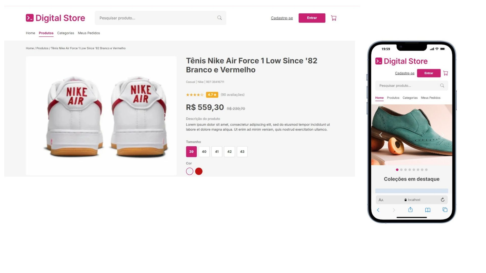

# Digital Store

Projeto final de Front-end Digital College: uma loja virtual feita com React, seguindo a documentação oficial e o design do Figma.

Protótipo base no Figma: [Acessar design](https://www.figma.com/design/nUk0ihM3x4u8JQtxUoAEJf/DRIP-STORE---DIGITAL-COLLEGE--Copy-?node-id=22-30&p=f)

> 🚀 **Deploy:** [Aceder à Digital Store](https://digital-store-mu-amber.vercel.app)

## Preview

## Tecnologias

- React + Vite
- React Router DOM
- Bootstrap Icons
- CSS puro (um arquivo por componente)

## Páginas

- **Home** (`/`): galeria de imagens, coleções em destaque e produtos em alta
- **Listagem** (`/products`): filtros, ordenação e busca por query string (`?filter=`)
- **Produto** (`/products/:id`): galeria com miniaturas, opções de tamanho e cor, botão de compra e produtos relacionados

## Componentes

Header, Footer, Logo, Layout, Section, Gallery, ProductCard, ProductListing, FilterGroup, ProductOptions e BuyBox.

## Responsividade

Layout adaptado para celular, com grade de 2 colunas na listagem e painel de filtros em tela cheia.

## Estrutura

    src/
    ├── components/   componentes reutilizáveis
    └── pages/        páginas e Layout

 
 

  Desenvolvido por Miciane Andrade💫

